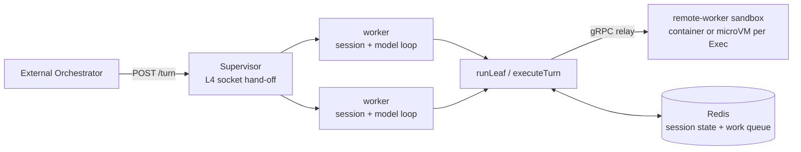

# MOCA — Micro Orchestrator for Cloud Agents

**Run stateful AI coding agents on a dense, warm process-manager runtime — sessions resume exactly where they left off.**


MOCA runs long-lived AI agents as **warm, dense sessions on a process-manager runtime (P6)**. An
agent process normally has to stay resident — holding its conversation, tool state, and working
directory in memory — while it waits for the next turn or for a human to approve a step. MOCA
decouples the agent's **state** (durable in Redis) and its **tool execution** (an isolated remote
sandbox — a container, or a Firecracker microVM per `Exec`) from the **agent process** itself, so
one supervisor hands connections to a fixed pool of warm workers: many sessions per worker, no
cold-start on the next request.

Capacity scales the boring way: **add process-manager pods, or size them up** — on a VM, bare
metal, or plain Kubernetes. The earlier scale-to-zero Knative + KEDA deployment is deprecated
([ADR-0041](docs/adrs/0041-deprecate-knative-keda-deployment.md)); see
[Migrating off the Knative/KEDA deployment](docs/migrating-from-knative.md).

The result is a **leaf-session backend**: an external orchestrator dispatches isolated units of
agent work ("leaves") over a simple HTTP + shared-volume contract — sync turns, detachable
streaming turns, and human-gated runs, with async fan-out and scheduled dispatch owed P6
follow-ups ([ADR-0034](docs/adrs/0034-vm-process-manager-socket-handoff.md)).

## Maturity

Labels apply to each deployment path, not to the project as a whole (definitions in the
[documentation map](docs/index.md#maturity-labels)).

| Path                                                 | Label      | Notes                                                                      |
| ---------------------------------------------------- | ---------- | -------------------------------------------------------------------------- |
| [Docker Compose](deploy/compose/README.md)           | Preview    | Five-minute trial, not production                                          |
| [Single VM](deploy/vm/README.md)                     | Preview    | The production path for one host                                           |
| [P6 on Kubernetes / OpenShift](deploy/k8s/README.md) | Preview    | Same process model as ordinary cluster workloads; first target for Stable  |
| [P4 microVM sandboxes](deploy/microvm/P4-ON-P6.md)   | Preview    | Per-`Exec` Firecracker VMs on a KVM host; known limits listed on that page |
| [Knative + KEDA](deploy/knative/README-kind.md)      | **Legacy** | Deprecated 2026-10-11; removal no earlier than end of October 2026         |

Criteria for Stable and the support policy are in
[Maturity and lifecycle](docs/reference/maturity-and-lifecycle.md). **Still on Knative?** Say so, or say you
depend on async fan-out or the CronJob, in the [tracking issue](https://github.com/rossoctl/moca/issues/490): the
removal date waits for you.

## Table of Contents

- [Maturity](#maturity)
- [Why](#why)
- [Architecture](#architecture)
- [Features](#features)
- [Quick Start](#quick-start)
- [Legacy: Knative + KEDA deployment](#legacy-the-knative--keda-deployment-deprecated)
- [How It Works](#how-it-works)
- [Dispatch Archetypes](#dispatch-archetypes)
- [Repository Layout](#repository-layout)
- [Evidence](#evidence)
- [Roadmap](#roadmap)
- [Documentation](#documentation)
- [Status & License](#status--license)

---

## Why

| Persistent agent                                    | MOCA                                                                |
| --------------------------------------------------- | ------------------------------------------------------------------- |
| Process stays resident between turns                | Warm worker pool — many sessions per worker, no cold-start          |
| State lives in process memory — lost on crash/evict | State lives in **Redis** — survives eviction, restart, and resume   |
| Tools execute in the agent process                  | Tools execute in an **isolated remote sandbox** (brain/hands split) |
| One process per session                             | Many sessions per worker; scale by **adding pods or sizing up**     |
| One invocation model                                | Sync, detachable streaming, human-gated                             |

The economics measurement ([experiment](https://github.com/rossoctl/moca-experiments/blob/main/knative/EXPERIMENTS.md),
run on the now-deprecated scale-to-zero path) showed the serverless shape consuming roughly a
quarter of the pod-seconds of an always-on agent. P6 trades scale-to-zero for density — many
sessions per worker with admission control — and keeps what that experiment bought on the
latency side: no autoscaler cold-start between turns.

---

## Architecture



| Component                 | Role                                                                                                                                                                                                                                                         |
| ------------------------- | ------------------------------------------------------------------------------------------------------------------------------------------------------------------------------------------------------------------------------------------------------------ |
| **Supervisor**            | L4-only listener; hands each accepted socket to a warm worker and never touches a response byte ([ADR-0034](docs/adrs/0034-vm-process-manager-socket-handoff.md))                                                                                            |
| **Worker pool**           | Fixed set of forked workers; many sessions per worker, bounded concurrent turns, admission control instead of autoscaling                                                                                                                                    |
| **Redis**                 | Durable session state (resume by `sessionId`), work queue (Streams), gate state                                                                                                                                                                              |
| **remote-worker sandbox** | Tool/code execution in a container — or a Firecracker microVM per `Exec` ([ADR-0035](docs/adrs/0035-per-exec-microvm-warm-standby.md)) — dialed in over the gRPC relay ([ADR-0024](docs/adrs/0024-sandbox-transport-remote-exec.md)); needs no inbound route |
| **Control plane**         | Multi-user identity and credentials (MU1); issues per-session tokens ([ADR-0033](docs/adrs/0033-multi-user-control-plane.md))                                                                                                                                |

> **Note:** The supervisor and its workers are the **same container image**: the supervisor forks
> `packages/knative-server/src/worker.ts` (the package name is historical — the code is
> P6-load-bearing). The "brain" (model inference + session logic) runs in a worker; the "hands"
> (command/tool execution) always run in the sandbox.

---

## Features

- **Warm, dense sessions** — a fixed worker pool serves many sessions each; no activator
  cold-start between turns, and capacity scales with pods, not autoscalers.
- **Durable resume** — sessions are append-only logs in Redis; a restarted worker recalls full
  conversation and state by `sessionId`, surviving process or pod death.
- **Brain/hands isolation** — the agent never executes tools in its own process; everything runs
  in a remote sandbox over the gRPC relay — container tier, or a microVM per `Exec`.
- **Human-in-the-loop gates** — a leaf can pause mid-run, report `paused`, and resume on an
  external approve/reject/abort verdict.
- **Volume-envelope contract** — orchestrators pass inputs and collect results as files, decoupling
  result size from HTTP limits.
- **Hardened by default** — non-root, read-only root filesystem, dropped capabilities where the
  substrate allows; isolation is enforced by the sandbox tier, not by trust.
- **Built on Pi** — wraps a pinned [`kagenti/pi`](https://github.com/kagenti/pi) coding agent through
  an injectable `SessionStorageBackend` seam; the agent itself is unmodified.
- **Promote a local Claude Code workflow** — `mocactl promote DIR` bundles your local skills and
  commands into a content-addressed bundle that a session or a leaf runs with, uploaded through the
  control plane (see [the guide](docs/guides/promote-claude-workflow.md)).

---

## Quick Start

Try the P6 runtime in five minutes, no root, with Docker Compose: the supervisor, the relay, Redis
and a sandbox on one machine.

> **Prerequisites:** `docker` (or a compatible runtime) with Compose, `curl`, and an
> Anthropic-compatible model credential.

```bash
curl -fsSL https://raw.githubusercontent.com/rossoctl/moca/main/deploy/compose/install.sh \
  | ANTHROPIC_API_KEY=sk-ant-... sh
```

Verify it works, then stop it (Redis state goes with it):

```bash
curl -s -H 'Content-Type: application/json' -d '{"prompt":"Run uname -a and tell me the kernel."}' \
  http://127.0.0.1:8080/turn
cd ~/.serverless-harness && docker compose down
```

Details, configuration and the multi-user control plane are in the
[Compose README](deploy/compose/README.md). To use the terminal client against a control plane,
install `mocactl` (Node 22+):

```bash
curl -fsSL https://raw.githubusercontent.com/rossoctl/moca/main/scripts/install-mocactl.sh | sh
```

Where to go next:

- **Choose an install path:** [`docs/get-started/`](docs/get-started/index.md).
- **Production, a dedicated VM or bare metal:** [`deploy/vm/`](deploy/vm/README.md).
- **Stay on Kubernetes or OpenShift:** [`deploy/k8s/`](deploy/k8s/README.md).
- **Guided tour:** [`docs/demos/vm-multi-user-demo.md`](docs/demos/vm-multi-user-demo.md): two
  users, one VM, two sandbox tiers (~40 min). All demos are indexed in [`docs/demos/`](docs/demos/).
- **Run your coding agent with every command in a microVM:** the SBX0 sandbox service,
  [`docs/sbx/user-guide.md`](docs/sbx/user-guide.md). Claude Code and OpenCode run with their own
  tools denied, so your laptop's tree is untouched until you pull the agent's work back; Codex and
  IBM Bob are supported too, with weaker containment the guide spells out.

---

## Legacy: the Knative + KEDA deployment (deprecated)

The original scale-to-zero deployment under [`deploy/knative/`](deploy/knative/) is **deprecated as
of 2026-10-11** ([ADR-0041](docs/adrs/0041-deprecate-knative-keda-deployment.md)): security and
breakage fixes only, removal no earlier than **end of October 2026** and only once its remaining
users have migrated. See [Migrating off the Knative/KEDA deployment](docs/migrating-from-knative.md).

---

## How It Works

1. **An orchestrator POSTs a turn** to `/turn` (or a leaf to `/runs`).
2. The **supervisor** accepts the connection and hands the socket to a warm **worker** — it never
   touches a response byte.
3. The worker runs the model loop; every tool call executes in a **remote sandbox** over the gRPC
   relay — container tier, or a microVM per `Exec`.
4. **Session state streams to Redis** as it goes, so the turn is resumable by `sessionId` even if
   the worker dies mid-run.
5. Capacity scales by **adding process-manager pods or sizing them up**; admission control
   (bounded concurrent turns per worker) replaces autoscaling.

---

### Promoting a local Claude Code workflow

Iterate on skills and commands locally in Claude Code, then promote them with `mocactl promote DIR`
(or `/promote DIR` inside the `mocactl` TUI). The bundle is built and credential-scanned on your
machine, uploaded through the control plane with no cluster credentials, and fixed to the session
you start with `mocactl run --config DIGEST`. Full guide:
[`docs/guides/promote-claude-workflow.md`](docs/guides/promote-claude-workflow.md).

---

## Dispatch Archetypes

The same backend serves three orchestration patterns, all validated end-to-end on Kind:

| Archetype             | Pattern                                                                                | Example use case                                     |
| --------------------- | -------------------------------------------------------------------------------------- | ---------------------------------------------------- |
| **A — Async fan-out** | `{async:true}` → Redis Streams → drained by KEDA ScaledJobs — **deprecated path only** | "Research 10 topics concurrently"                    |
| **B — Human gate**    | Leaf pauses (`paused`) → external verdict → resume/terminate                           | "Draft a clause, pause for legal sign-off, finalize" |
| **C — Scheduled**     | CronJob → `cron-dispatch` posts async leaves — **deprecated path only**                | "Summarize yesterday's tickets at 02:00 daily"       |

B is served by the P6 runtime today. A and C have **no P6 equivalent yet** — the async drainer
and the scheduled on-ramp are owed follow-ups flagged in
[ADR-0034](docs/adrs/0034-vm-process-manager-socket-handoff.md) and
[ADR-0041](docs/adrs/0041-deprecate-knative-keda-deployment.md); they work only on the deprecated
Knative/KEDA path.

---

## Repository Layout

```text
moca/
├── harness/               # Pi SessionStorageBackend adapter (write-behind) + promote CLI
├── packages/
│   ├── supervisor/        # P6 process manager: L4 listener, socket hand-off, worker pool
│   ├── knative-server/    # HTTP server + P6 worker entry points (name is historical)
│   ├── k8s-sandbox/       # Sandbox transports (K8s pod-exec half deprecated, ADR-0041)
│   ├── session-backend/   # Generic append-only LogStore + Redis Streams impl
│   ├── work-queue/        # Redis Streams work queue (async dispatch)
│   ├── sandbox-relay/     # gRPC relay between control plane and remote-worker sandboxes
│   ├── control-plane/     # Multi-user control plane, credential issuance
│   ├── config-bundle/     # Promoted config bundle loading
│   ├── ibac-stub/         # IBAC stub
│   └── mocactl/           # MOCA terminal client for the control plane
├── remote-worker/         # Go: container + microVM sandbox workers
├── deploy/
│   ├── vm/                # P6 single-VM systemd deployment (production)
│   ├── k8s/               # P6 on Kubernetes/OpenShift (first-class)
│   ├── compose/           # Docker Compose trial of the P6 runtime
│   ├── microvm/           # P4 Firecracker microVM deployment
│   └── knative/           # Knative/KEDA deployment — DEPRECATED (ADR-0041)
├── pi-fork/               # Pinned Pi coding agent (submodule)
└── docs/                  # Docs map, guides, specs, ADRs, demos, migration guide
```

---

## Evidence

Behaviour and economics are backed by reproducible experiments rather than claims:

- **[`moca-experiments/knative/EXPERIMENTS.md`](https://github.com/rossoctl/moca-experiments/blob/main/knative/EXPERIMENTS.md)**
  — cluster experiments E1 (economics), E3 (mobility), E4 (recovery), run live on Kind. Moved to
  a separate repo 2026-09-25 (see `docs/specs/2026-09-24-ra1-density-cutover-and-repo-rearchitecture-design.md`).
- **[`docs/archive/experiment-results.md`](docs/archive/experiment-results.md)**: E2 (reconstruction cost) and E5
  (budget enforcement), a dated write-up from June 2026. The code these ran from now lives in
  [`moca-experiments/experiments/`](https://github.com/rossoctl/moca-experiments/tree/main/experiments).
- **[`deploy/knative/SMOKE.md`](deploy/knative/SMOKE.md)**: the deprecated Knative path's smoke
  record, kept as history.

---

## Roadmap

The [milestone registry](docs/specs/README.md) is the source of truth for the status of every
milestone, including the process manager (P6), the microVM tier (P4), the multi-user control plane
(MU), and the zero-trust credential plane (Z track), whose parts are at different stages. Open
questions and planned documentation work are in [`docs/REORG-PLAN.md`](docs/REORG-PLAN.md).

---

## Documentation

Start at the [documentation map](docs/index.md).

| I want to...                      | Go to                                                                                                                                                                                                                                                              |
| --------------------------------- | ------------------------------------------------------------------------------------------------------------------------------------------------------------------------------------------------------------------------------------------------------------------ |
| Pick an install path              | [Get started](docs/get-started/index.md)                                                                                                                                                                                                                           |
| Leave the Knative/KEDA deployment | [Migration guide](docs/migrating-from-knative.md)                                                                                                                                                                                                                  |
| Run it for several users          | [Multi-user guide](docs/guides/manage-multi-user-sessions.md)                                                                                                                                                                                                      |
| Attach a sandbox on another host  | [Remote sandbox guide](docs/guides/remote-sandbox.md)                                                                                                                                                                                                              |
| Run my coding agent in a sandbox  | [Sandbox service user guide](docs/sbx/user-guide.md)                                                                                                                                                                                                               |
| Use Codex or IBM Bob with it      | [Codex](docs/sbx/user-guide.md#codex-cli); [IBM Bob](docs/sbx/user-guide.md#ibm-bob)                                                                                                                                                                               |
| Promote a Claude Code workflow    | [Guide](docs/guides/promote-claude-workflow.md)                                                                                                                                                                                                                    |
| Look up an environment variable   | [Configuration reference](docs/reference/configuration.md)                                                                                                                                                                                                         |
| Look up a `mocactl` command       | [`mocactl` reference](docs/reference/cli-mocactl.md)                                                                                                                                                                                                               |
| Know what changes need notice     | [Change policy](docs/reference/change-policy.md)                                                                                                                                                                                                                   |
| Understand the security model     | [Security model](docs/reference/security-model.md), [hardening checklist](docs/operations/hardening.md)                                                                                                                                                            |
| Operate it (Kubernetes)           | [Operations](docs/operations/index.md)                                                                                                                                                                                                                             |
| Understand how it works           | [Concepts](docs/concepts/index.md)                                                                                                                                                                                                                                 |
| Look up a term                    | [Glossary](docs/glossary.md)                                                                                                                                                                                                                                       |
| Call the HTTP API                 | [HTTP API guide](docs/reference/http-api.md), [leaf envelope](docs/reference/leaf-and-envelope.md), [`docs/api/openapi.yaml`](docs/api/openapi.yaml), [`docs/api/harness-openapi.yaml`](docs/api/harness-openapi.yaml), [Context service](docs/context-service.md) |
| Follow a guided walkthrough       | [Demos](docs/demos/README.md)                                                                                                                                                                                                                                      |
| See why a decision was made       | [ADRs](docs/adrs/README.md), [milestone registry](docs/specs/README.md)                                                                                                                                                                                            |
| Build or contribute               | [`CONTRIBUTING.md`](CONTRIBUTING.md), [`harness/README.md`](harness/README.md), [docs conventions](docs/CONTRIBUTING-DOCS.md)                                                                                                                                      |

---

## Status & License

This is explorative work and every deployment path except the deprecated Knative one is Preview
(see [Maturity](#maturity)). The warm-worker-pool runtime, durable resume, sandbox isolation
(container and microVM tiers), and the multi-user control plane are built. Async fan-out and
scheduled dispatch exist only on the deprecated path and have no P6 equivalent yet. Interfaces may
change.

Licensed under the [Apache License 2.0](LICENSE).
