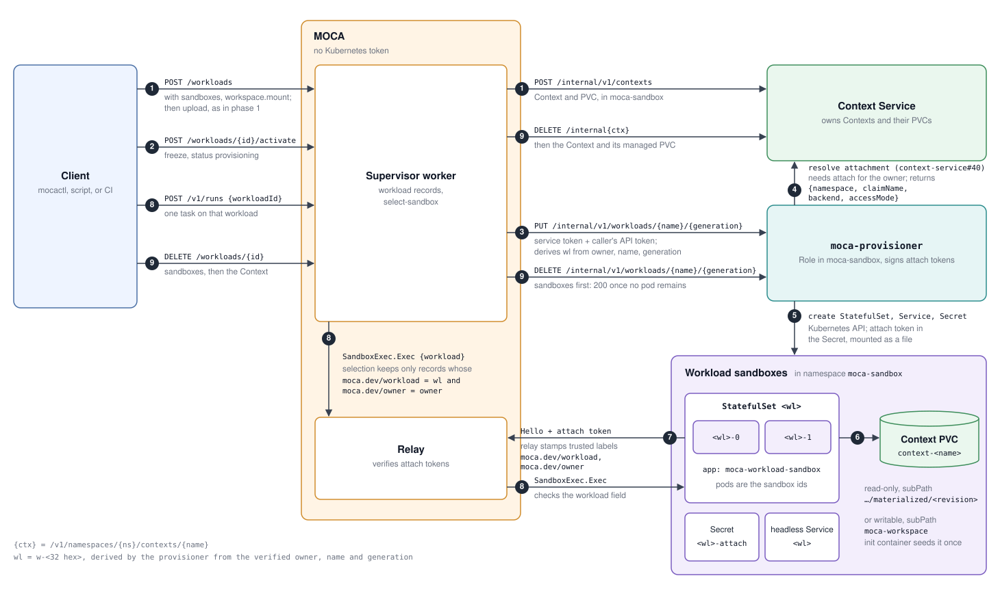

# Per-workload sandboxes and storage (`/workloads` phase 2) — Design

**Date:** 2026-10-16 · **Status:** Proposed · **Issue:**
[#476](https://github.com/rossoctl/moca/issues/476) (phase 2: per-workload sandboxes and storage),
which also took over the writable-workspace threads of #517 (context for delegated tasks).
**Decision record:** [ADR-0043](../adrs/0043-workload-sandboxes-provisioner.md).
**Builds on (reuse, no redesign):** the `/workloads` lifecycle
(`packages/knative-server/src/workloads.ts`);
[per-subject claim names](2026-10-15-per-subject-claim-names-design.md) (#543, per-subject claim
names for #358);
[P6 on Kubernetes](2026-10-02-p6-on-kubernetes-slice1-design.md) and its tiers and affinity
([slice 3](2026-10-04-p6-on-kubernetes-slice3-design.md));
[MI1](2026-09-28-moca-multi-user-isolation-design.md) (multi-user isolation).
**Amends (on acceptance):** MI1 §2.3, §9.1 and §13 (§9).
**Storage decision (2026-10-22):** MOCA owns each workload's PVC (§5, §11 item 3). Context Service
is used exactly as in phase 1, so
[rossoctl/context-service#40](https://github.com/rossoctl/context-service/issues/40) (trusted
resolve-attachment) and
[rossoctl/context-service#59](https://github.com/rossoctl/context-service/issues/59) (caller-named
claims) are no longer on phase 2's path.

## 1. Problem

MOCA's Kubernetes deployment runs P6 (the process-manager runtime: a supervisor and its forked
workers) against a fixed pool of sandbox workers. The pool is one static StatefulSet,
`moca-sandbox` (`deploy/k8s/base/sandbox.yaml`), sized at install time by `SH_SANDBOX_COUNT`.
Nothing creates or deletes a sandbox while MOCA runs. Phase 1 of `/workloads` therefore copies a
workload's frozen context into whichever shared sandbox a run lands on
(`harness/src/context-overlay.ts`), and #532 (writable per-run copy) gives each run a throwaway
writable copy. That leaves three gaps:

- **No isolation between users.** Alice's and Bob's runs share sandboxes: one `/workspace`, one
  process list, one Unix user. `context-overlay.ts` says so itself: isolation between users needs
  separate sandboxes.
- **No durable working tree.** A writable copy is discarded after its run, so an always-on
  workload (a BugStone pipeline with its repositories loaded) cannot keep state.
- **Copies, not mounts.** Every run re-delivers the bundle, within the 256 MiB bundle limit.

#476 asks that each workload get its own sandboxes and, where useful, a mounted Context PVC, with
`DELETE /workloads/{id}` removing all of it.

### 1.1 Facts this design rests on (upstream/main `068711f1`)

- **Registration.** A worker dials the relay and sends `Hello{sandboxId, labels, capabilities}`.
  The relay writes the labels into `sh:sandbox:records` exactly as sent
  (`packages/sandbox-relay/src/relay.ts`, the `frame.hello` handler). The attach token is looked up
  as `$SH_RELAY_TOKEN_DIR/<id>`, then `SH_RELAY_TOKEN_<id>`, then the shared `SH_RELAY_TOKEN`
  (`makeDefaultValidateToken`, `main.ts`). The directory is used only for ids matching
  `^[A-Za-z_][A-Za-z0-9_]*$`, so the dashed `moca-sandbox-N` pods all fall through to the one shared
  token.
- **Selection.** `harness/src/select-sandbox.ts` filters records by `moca.dev/tier` and nothing
  else. It runs in the worker, not in the supervisor.
- **Redis is not a trusted store.** The supervisor's workers hold the same `REDIS_URL` as the relay
  (`deploy/k8s/base/redis.yaml`: "whoever can write it chooses the executor for every turn").
- **RBAC.** The supervisor, relay and sandboxes run with `automountServiceAccountToken: false`. The
  control plane has a Role on Secrets in `moca-credentials` only.
- **Every workload already has a PVC.** `createContext` (`context-service.ts`) always asks Context
  Service for a managed PVC, hard-coding `accessMode: ReadWriteOnce`; the sandbox never mounts it.
- **Workload lifecycle.** `creating`, `awaiting_upload`, then activation freezes the revision and
  the record is `ready`; delete goes through `deleting` to `deleted`. A frozen Context takes no
  further upload (`context_frozen`).
- **Context Service.** It names a managed PVC `context-<name>`, places it in the namespace the
  request names (`CONTEXT_SERVICE_NAMESPACE` on MOCA's side), and holds a ClusterRole over PVCs,
  ConfigMaps and helper pods in every namespace. Upload and export run in short-lived helper pods
  that mount the PVC (`internal/kube/context_upload.go`); they set no node affinity. Delete answers
  `409 in_use` while any pod mounts the claim (`manager.go`). Revisions live on the PVC under
  `.context-service/materialized/<digest>/`, and the revision id is the digest of exactly that
  directory.
- **Precedent.** The unmerged P6 rework of #455 (kept locally as a reference, never pushed) created
  agent-sandbox `Sandbox` CRs per workload, labelled with the workload, with the claim mounted
  read-only at `subPath: .context-service/materialized/<revision>`, and rolled back on failure.

### 1.2 Acceptance (#476)

1. On Kind, Alice and Bob each create a workload and delegate tasks to it.
2. A run of Alice's workload executes only on Alice's workload sandboxes. A run with no workload
   never executes there.
3. Neither user can see the other's context or working tree, whatever their sandboxes send at
   registration.
4. A workload can mount its Context read-only, or writable for delegated tasks, with no per-run
   copy.
5. `DELETE /workloads/{id}` removes the sandboxes, their token Secret and PVC, and the Context, and
   leaves no orphans when a step fails.
6. Phase 1 workloads, created without the new fields, behave exactly as today.

## 2. Design overview



1. **Create the workload:** the client calls `POST /workloads` with `sandboxes` and
   `workspace.mount`, and uploads the bundle with the grant, as in phase 1. The worker creates the
   Context (`POST /internal/v1/contexts`), as in phase 1.
2. **Activate:** `POST /workloads/{id}/activate` freezes the revision and moves the record to
   `provisioning`.
3. **Request sandboxes:** the worker calls `PUT /internal/v1/workloads/{name}/{generation}` on
   `moca-provisioner` with its service token and the caller's API token; the provisioner derives
   `wl` from the verified owner, name and generation.
4. **Create the storage:** the provisioner creates PVC `<wl>` in `moca-sandbox`, sized and classed
   from the request (§5.1).
5. **Create the sandboxes:** through the Kubernetes API, the provisioner creates StatefulSet `<wl>`,
   headless Service `<wl>` and Secret `<wl>-attach` (the attach token, mounted as a file) in
   `moca-sandbox`.
6. **Seed and mount:** once, an init container fills the PVC from the frozen bundle, which the
   worker downloads from Context Service's export as phase 1 delivery does and hands to the
   provisioner (§5.2). The sandbox pods `<wl>-<n>` mount the PVC at `/workspace/context`:
   read-only at `subPath: revision/<revision>`, or writable at `subPath: moca-workspace`.
7. **Register with the relay:** each pod attaches to the relay with `Hello` + attach token; the
   relay stamps the trusted `moca.dev/workload` and `moca.dev/owner` labels, whatever `Hello` sent.
   Once `count` sandboxes are registered the record is `ready`.
8. **Run a task:** `POST /v1/runs` names the workload; selection keeps only records whose
   `moca.dev/workload` and `moca.dev/owner` match, and the worker runs the task with
   `SandboxExec.Exec` carrying the `workload` field, which the relay checks.
9. **Delete:** `DELETE /workloads/{id}` removes the sandboxes and their PVC
   (`DELETE /internal/v1/workloads/{name}/{generation}`, `200` once no pod remains), then the
   Context (`DELETE /internal/v1/namespaces/{ns}/contexts/{name}`), as in phase 1.

In short: a new `moca-provisioner` (§4, ADR-0043), the only MOCA component with Kubernetes
permissions in the sandbox namespace, creates each workload's sandbox pods at activation (§6). It
signs a token from which the relay sets the pods' workload and owner labels (§3), and creates and
mounts a PVC of the workload's own, seeded from its Context's frozen revision (§5).
`POST /workloads` gains two optional fields (§7).

## 3. Trusted workload labels

### 3.1 The binding token

The provisioner holds an Ed25519 key. For each workload it mints one **attach token**, a JWT whose
header has `alg: EdDSA`, `typ: moca-attach+jwt` and a `kid`, with these claims, all required:

| Claim | Meaning                                                                            |
| ----- | ---------------------------------------------------------------------------------- |
| `iss` | `moca-provisioner`                                                                 |
| `aud` | `moca-relay-attach`, never a session, API or sandbox token (seed use: §5.2)        |
| `wl`  | the workload key: the record's existing Context name, `w-<32 hex>` per reservation |
| `own` | the owner scope: `recordScope(owner)`, the hash the record key already uses        |
| `gen` | the workload generation, so a re-created workload gets a different binding         |
| `tr`  | the tier, `container`                                                              |
| `n`   | the workload's `sandboxes.count`; the relay accepts only ordinals below it         |
| `iat` | issued at                                                                          |
| `exp` | expiry, `iat` + `MOCA_ATTACH_TOKEN_TTL_S` (default 86400, one day)                 |
| `jti` | a random id, for logs                                                              |

The token goes into a per-workload Secret in `moca-sandbox`. The pods mount that Secret as a file
(`SANDBOX_TOKEN_FILE`, not an env var and not a `subPath`, so the kubelet refreshes it in place).
The relay verifies the token with public keys only (`MOCA_ATTACH_PUBLIC_KEYS`, a
`<kid>:<base64 SPKI>` list in the format of `SH_SESSION_TOKEN_PUBLIC_KEYS`), so the relay cannot
mint one and a sandbox cannot forge one. The name `moca-attach+jwt` stays clear of SBX0's
`moca-sandbox+jwt` client token (#546, SBX0 sandbox service), which authorizes callers, not workers.

**Expiry and rotation.** The provisioner re-mints a workload's token once less than half its
lifetime remains, on its reconciler loop (§6.2), and overwrites the Secret. It never reads the
Secret back (§4.1): the token's `iat`, `exp`, `kid` and `n` are annotations on the workload's
StatefulSet (`moca.dev/attach-iat`, `moca.dev/attach-exp`, `moca.dev/attach-kid`,
`moca.dev/sandbox-count`), updated with each mint. The worker re-reads the
file whenever it dials, and when the file changes it reconnects with the new token at its next
idle moment (no Exec in flight). The relay closes an attach stream when its token's `exp` passes,
so no stream outlives its token. The worker polls the file while attached and, once it holds a
different token, ends the stream at the first moment no Exec is in flight; the re-mint lands with
half a TTL to spare, so the close at `exp` is a backstop, not the rotation path.
Rotating the provisioner's key is the usual overlap: add the new
`<kid>` to `MOCA_ATTACH_PUBLIC_KEYS`, switch the provisioner to it (every token is re-minted within
half a TTL), and drop the old key one TTL later. A projected, pod-bound credential (a
ServiceAccount token with the relay as audience, checked through TokenReview) would bind the token
to one pod; it needs the relay to call the Kubernetes API and is left as a later option.

**The worker can read its own token.** `commandEnv` keeps the token out of a command's environment,
but model code runs as the same UID (1001) in the same container as the worker process, so it can
read the token from the mounted file or from `/proc/<worker pid>/`. The design assumes model code
holds its workload's token; §9 records what that is worth to it.

**Why a signed token and not a store lookup.** The proposal was a trusted
`sandboxId → {workload, owner}` store. In this deployment the only shared store is Redis, and the
workers can write it, so a binding there is no more trusted than a `Hello` label. A Redis ACL that
gives the provisioner a write-only prefix would work, but it needs ACL users the deployment does not
have, and the relay would still do a lookup on every attach. A signed token carries the binding
itself, adds no store, and keeps the relay's attach path synchronous.

**One token per workload, not per sandbox.** A StatefulSet's pods share one template, so they
cannot each read a different Secret. All of a workload's sandboxes belong to one owner, so a token
stolen from one of them lets the thief register only another sandbox of that same workload, under
an ordinal below `n`, until `exp`. That crosses no user boundary: MI1 §9.2's argument for
per-sandbox tokens, applied one level up.

### 3.2 What the relay does on `Hello`

- **Token is an attach token.** The relay requires an unexpired token, and a `sandboxId` matching
  `^<wl>-(0|[1-9][0-9]*)$` whose ordinal is below `n`, then writes the record with
  `moca.dev/workload=<wl>`, `moca.dev/owner=<own>` and `moca.dev/tier=<tr>`, overwriting whatever
  `Hello` sent for those three keys. Other labels and capabilities pass through as today.
- **Token is a shared or per-id token (today's path).** The relay **removes** any
  `moca.dev/workload` or `moca.dev/owner` label from `Hello`. Without this, a shared-pool sandbox
  could claim to be Alice's.
- The duplicate-id refusal is unchanged, so a stolen token cannot take over a live sandbox's id.

A deleted workload's token stays valid until its `exp`, and nothing re-mints it. Until then, a copy
kept by its model code can register only a sandbox labelled with a workload key that no record has
any more; re-creating the same name gives a new `gen` and therefore a new `wl`. No run routes
there, so the token is harmless after delete.

### 3.3 Selection and the relay's Exec check

- **Selection** (`select-sandbox.ts`, in the worker). A run that names a workload considers only
  records whose `moca.dev/workload` equals the workload's key **and** whose `moca.dev/owner`
  equals `recordScope` of the run's owner, a second check on the same signed binding. A run
  without one excludes every record that carries the label. When the workload has no live sandbox,
  the run waits for the P6.3 affinity grace and then fails with
  `503 workload_sandbox_unavailable`. It never falls back to the shared pool.
- **Relay check (defense in depth).** The SandboxExec request gains an additive `workload` field
  (ADR-0024's rules). The relay refuses an Exec to a sandbox with a `moca.dev/workload` label unless
  the field matches, and refuses a non-empty `workload` on a sandbox without one.

The relay check stops bugs, not a compromised worker. The worker fills in `workload`, and nothing
signed tells the relay which user a run belongs to. That needs MI1 S2's control-plane-signed
grants (MI1 §4.2 I2). Until then the worker remains the trust root for routing, as it is today.

## 4. The provisioner

### 4.1 What it is

`moca-provisioner` is a small HTTP service in the `moca` namespace (`packages/provisioner`,
`@moca/provisioner`). Its ServiceAccount is bound to one Role in `moca-sandbox`:

| Resource                 | Verbs                            | Why                                          |
| ------------------------ | -------------------------------- | -------------------------------------------- |
| `apps/statefulsets`      | create, get, list, patch, delete | one per workload                             |
| `secrets`                | create, update, delete           | the workload's attach token, re-minted       |
| `services`               | create, get, delete              | the StatefulSet's headless governing Service |
| `pods`                   | get, list                        | readiness, and the reconciler's view         |
| `persistentvolumeclaims` | create, get, delete              | the mounted workload's own PVC (§5)          |
| `podtemplates`           | get, on `moca-workload-sandbox`  | the operator's pod template (§4.2)           |

No create on bare pods, and no read on Secrets: the provisioner writes its workloads' tokens blind
(create, or an unconditional update) and cannot read any Secret, `moca-relay-attach` (the shared
pool's token) included.

**Admission.** Create on StatefulSets would still let a compromised provisioner run a pod that
mounts any Secret in the namespace, or runs as another ServiceAccount. A ValidatingAdmissionPolicy
(`admissionregistration.k8s.io/v1`, Kubernetes 1.30 or newer), matched on the provisioner's
ServiceAccount, refuses any StatefulSet, Service or Secret it writes or deletes in `moca-sandbox`
unless: a StatefulSet or Service is named `^w-[0-9a-f]{32}$` and a Secret
`^w-[0-9a-f]{32}-attach$` (Opaque); the StatefulSet and its pods are labelled
`app: moca-workload-sandbox`; a Service is headless (`ClusterIP`, `clusterIP: None`) with no
ports, external IPs or load-balancer fields, and selects exactly `app: moca-workload-sandbox` and
its own `moca.dev/workload`; the pod runs as `moca-workload-sandbox` with
`automountServiceAccountToken: false`; its volumes are only `emptyDir`, `configMap`, `downwardAPI`
and its own `<name>-attach` Secret (an allow-list), and its only Secret reference in `secretKeyRef`
or `envFrom` is that one too; and it has no host namespace, privileged or escalating container,
added capability, or claim template. The Role says which verbs; the policy says which objects.

**Network.** Its egress is the Kubernetes API server only: `setup.sh` fills in the `kubernetes`
Service's ClusterIP and its EndpointSlice addresses, and refuses to enable the feature when it
cannot read them.

**One replica.** The owner cap (§6.3) counts the owner's StatefulSets and then creates one, so two
concurrent PUTs could both pass it. The provisioner serializes PUTs per owner in process, and runs
as exactly one replica with the `Recreate` strategy; scaling it out needs a lock in the API.

The governing Service is headless with no ports, as the shared pool's is: a workload sandbox
accepts no connections. The provisioner has no rights outside `moca-sandbox`. PR 3 added create,
get and delete on PVCs there, since the provisioner owns the workload's PVC (§5.1, 2026-10-22).
That is not limited to the workload's own claim: the Role has no `resourceNames`, so `get` reaches
any PVC in `moca-sandbox` (admission never sees a GET), and the admission policy holds create and
delete to `w-<32 hex>` names, which is any workload's PVC. A created PVC must be a new, empty
Filesystem claim (no `dataSource`, `dataSourceRef`, `volumeName` or `selector`), so it cannot clone
another workload's claim or bind its volume. That the provisioner touches only the workload's own
PVC rests on its code deriving the name from the verified owner. The control plane, supervisor and
relay stay without a Kubernetes token.

Its internal API is reached only by the supervisor's workers (NetworkPolicy):

```
PUT    /internal/v1/workloads/{name}/{generation}   # create or update; idempotent by (wl, gen)
GET    /internal/v1/workloads/{name}/{generation}   # replicas wanted and ready
DELETE /internal/v1/workloads/{name}/{generation}   # delete; 200 once no pod of it remains
PUT    /internal/v1/workloads/{name}/{generation}/bundle   # the frozen bundle to seed from (§5.2)
```

The `PUT` body carries `count`, `tier`, `mount` and the frozen revision; no request carries a
workload key.

**Caller authentication.** The worker presents a service token (`MOCA_PROVISIONER_TOKEN`, one
caller credential per `/internal` endpoint, MI1 I8) **and** forwards the caller's own API token.
The provisioner verifies that token with `SH_SESSION_TOKEN_PUBLIC_KEYS`, as the supervisor already
does, and takes the owner from it. It then derives the workload key itself, exactly as
`workloads.ts` names the Context: `wl = "w-" + sha256(owner \0 name \0 generation)`, first 32 hex
characters. A worker cannot name another user's `wl`, so a compromised worker can provision, and
mint bindings, only for workloads of users whose tokens it currently holds. The reconciler acts
without a user token, but it only deletes.

### 4.2 What it creates

For workload key `wl`:

- Secret `<wl>-attach`: the attach token.
- Service `<wl>`: headless, no ports, the StatefulSet's governing Service.
- StatefulSet `<wl>`: `replicas = sandboxes.count`, pods labelled `app: moca-workload-sandbox`,
  `moca.dev/workload`, `moca.dev/owner`, and annotated with the record key and generation. The pod
  spec is the PodTemplate `moca-workload-sandbox` in `moca-sandbox`, an operator's manifest that
  starts as the shared pool's container (`sandbox.yaml`: image, resources, relay address, non-root,
  `drop: ALL`, no service-account token, RuntimeDefault seccomp) without its relay token. The
  provisioner adds only the binding: labels, `SANDBOX_ID`, `SANDBOX_TIER`, and the attach token
  mounted at `/run/moca-attach/token` (`SANDBOX_TOKEN_FILE`). Callers choose nothing in the pod
  spec except count, tier and mount mode; the admission policy (§4.1) holds the result safe
  whatever the template says.
- The pods get their own label so the shared StatefulSet's selector (`app: moca-sandbox`) never
  matches them. A static NetworkPolicy for `app: moca-workload-sandbox`, installed with the
  feature, gives them the shared pool's egress: the relay's attach port and the public internet,
  without private ranges, so one workload's pods cannot reach another's.

Everything the feature adds -- the provisioner, its RBAC and policies, the template, the admission
policy and the namespace quota -- is the Kustomize component `deploy/k8s/base/workload-sandboxes`,
which `setup.sh` adds only with `SH_WORKLOAD_SANDBOXES=1`. Without it, every target renders exactly
as before. Turning it off is refused while a workload StatefulSet exists, unless
`--delete-workload-sandboxes` deletes them too.

A StatefulSet, not bare pods: a pod that dies comes back with the same name, so the same sandbox
id, and P6.3 affinity carries the workload's sessions to it (§10, restart continuity). The pods
are named `<wl>-<n>` (at most 36 characters), which is also their `SANDBOX_ID`.

### 4.3 Why a separate Deployment (summary of ADR-0043)

| Option                                                 | Verdict                                                                                                                                                                                                                                 |
| ------------------------------------------------------ | --------------------------------------------------------------------------------------------------------------------------------------------------------------------------------------------------------------------------------------- |
| **A.** `moca-provisioner`, its own Deployment and Role | **Chosen.** Smallest holder of the new permission; rendering a pod spec from request data happens away from signing keys                                                                                                                |
| **B.** Inside the control plane                        | No new Deployment, and it already has a token. But the control plane holds the signing keys and credential store (MI1 §4.3: "everything"), and is the internet-facing front door. Adding pod-spec rendering there grows the crown jewel |
| **C.** In the supervisor's workers                     | Refused by #476 itself: the workers process model output and run without a token on purpose                                                                                                                                             |
| **D.** agent-sandbox `Sandbox` CRs                     | Not an alternative to the component: something still needs RBAC on the CRs. It is a backend choice, and it adds a CRD and controller to every install. Recorded as a later backend behind the same API, for its warm pools              |
| **E.** Context Service creates sandboxes again         | Removed on purpose in rossoctl/context-service#51 (Sandbox provisioning removed): MOCA owns execution, Context Service owns storage                                                                                                     |
| **F.** Static per-user sandboxes (MI1 §9.1 option B)   | No dynamic workloads; an operator edits a file per user                                                                                                                                                                                 |

## 5. Storage

Decided 2026-10-22 (§11 item 3): MOCA owns each workload's PVC. Context Service is used exactly as
in phase 1 (upload grant, upload, freeze, export of the frozen revision) and is not changed.

### 5.1 The workload's PVC

A pod can mount only a PVC in its own namespace, so the provisioner creates the workload's PVC in
`moca-sandbox`, alongside the StatefulSet: PVC `<wl>`, labelled and annotated as the StatefulSet
is, sized by `workspace.size` and classed by `workspace.storageClass` within the caps of §6.3. Its
access mode is `ReadWriteOnce`, or `ReadWriteMany` for a class the allowlist marks `rwx` (§5.4).
The pods mount it as a plain `persistentVolumeClaim` volume, not through `volumeClaimTemplates`,
which the admission policy refuses (§4.1).

Context Service's side does not move: the Context, the managed PVC `createContext` asks for, its
helper pods and `CONTEXT_SERVICE_NAMESPACE` stay as they are, and no pod mounts that PVC. A phase 2
workload therefore holds its revision twice, once in each PVC, and a `writable` one three times:
Context Service's PVC, `revision/<revision>` and `moca-workspace`. `workspace.size` must cover the
compressed bundle, which the seed downloads onto the claim before extracting it, plus its inflated
size once for `read-only`, and twice plus the run's own writes for `writable`, and a margin for the
filesystem (10% and 16 MiB); the worker refuses a size below that with
`400 workspace_size_too_small`, before any seed can hit `ENOSPC`.

**What PR 3 adds to the provisioner's permissions.** The Role gains create, get and delete on
`persistentvolumeclaims` in `moca-sandbox`. The admission policy (§4.1) gains PVCs: the
provisioner may create or delete only a PVC named `^w-[0-9a-f]{32}$` whose StorageClass is on the
allowlist, created empty as a Filesystem claim (no `dataSource`, `dataSourceRef`, `volumeName`,
`selector` or Block mode), and a workload pod may mount no PVC but its own `<wl>`, and attach no
volume as a raw device (`volumeDevices`).

### 5.2 Seeding

The PVC is filled once, at provisioning, from the Context's frozen revision, through the same bundle
export phase 1 delivery uses. The worker downloads the bundle as phase 1 does
(`GET /internal/v1/namespaces/{ns}/contexts/{name}/revisions/{sha256}/bundle`, with phase 1's size,
inflate and entry ceilings) and hands it to the provisioner with
`PUT /internal/v1/workloads/{name}/{generation}/bundle` before the `PUT` that creates the
StatefulSet. The provisioner holds it in memory until the seed has run, within
`MOCA_PROVISIONER_SEED_BUDGET_BYTES` (default 1 GiB, about four bundles at phase 1's 256 MiB
ceiling) across all workloads waiting to seed, and at most half of it per owner. A `PUT …/bundle`
reserves its `Content-Length` (required) before its body is read, so held bundles and hand-offs in
flight together stay within the budget; one that would exceed it answers `503 seed_budget_full`
with `Retry-After`, and the worker's activate answers the same, so a burst of activations queues on
the client instead of growing the provisioner's memory. A bundle is held for
`MOCA_PROVISIONER_SEED_HOLD_S` (default 600 s) at most, seeded or not, so a workload whose pod 0
never initializes (a Pending claim, a crash-looping seed) does not keep its share; each activate
resends it and restarts the hold. The init container
fetches it from the provisioner's seed port (`GET /seed/v1/bundle`) with the workload's attach token
(`SANDBOX_TOKEN_FILE`) as its bearer, and the token's `wl` and `gen` pick the bundle. So the
provisioner needs no Context Service credential, and the bytes come from the same trusted export as
in phase 1.

This adds one NetworkPolicy pair: workload pods may reach the provisioner's seed port, which serves
only that `GET`. The seed port is a separate listener on its own port (8081), so the NetworkPolicy
that keeps `/internal/v1` to the supervisor's workers still holds: workload pods reach 8081 only,
and nothing on 8081 routes to `/internal/v1`. **The attach token gains a second audience here.** The
seed port accepts it as its bearer, checking `typ`, `iss`, `aud: moca-relay-attach`, `exp` and its
own key, and only there; no other provisioner route accepts it. That widens the token's use, which
is acceptable: its only extra power is reading its own workload's bundle. Model code shares the
pod's network and holds the token, so it can fetch that bundle, which it can read anyway once
seeded. A provisioner restart before the seed loses the bundle, as does the hold running out. The
seed port then answers
`404 seed_bundle_missing`, the init container keeps failing, and the provisioner's `GET` reports
`seed: bundle_missing`, which the worker surfaces on `GET /workloads/{id}` as `provisioning` with
`error: seed_bundle_missing`. The retry is client-driven: the next `POST /workloads/{id}/activate`
sends the bundle again, and the error clears once the workload is `ready`.

The PVC's layout:

| Path                   | Holds                                           | Written by                |
| ---------------------- | ----------------------------------------------- | ------------------------- |
| `revision/<revision>/` | the frozen revision, extracted, read-only       | the seed, once            |
| `moca-workspace/`      | a writable copy of the revision, writable mount | the seed, then model code |

### 5.3 Mount modes

| `workspace.mount` | Volume                | Mounted at `/workspace/context`                                      |
| ----------------- | --------------------- | -------------------------------------------------------------------- |
| `read-only`       | PVC, `readOnly: true` | `subPath: revision/<revision>`, read-only                            |
| `writable`        | PVC, read-write       | `subPath: moca-workspace`, read-write, seeded once from the revision |

The run's working directory is the mount, rooted at its `workspace/` directory under the same rule
`context-overlay.ts` uses today.

**Writable mounts never expose `revision/`.** The tree under `revision/<revision>/` is what the
Context Service revision id names. A writable mount of it, or of the claim root, would let model
code change a revision behind its id. So "writes stop being copies" holds per run, not per
workload: an init container (MOCA's image, not model code) copies the revision into
`moca-workspace/` once, and every later run writes that tree in place. The main container mounts
only `moca-workspace`.

**The seed cannot be steered into `revision/`.** Model code can write `moca-workspace/`, delete
things there and plant symlinks such as `a -> ../revision/<rev>/a`. Three rules keep a later seed
from following them:

- **No container mounts both trees writable, or the claim root.** The seed runs as two init
  containers. The first mounts `subPath: revision` read-write, and no `moca-workspace`; it
  extracts the bundle into `revision/<revision>/` and removes write permission. The second, for a
  writable mount only, mounts `subPath: revision/<revision>` read-only and `moca-workspace` as a
  separate read-write mount. A symlink in `moca-workspace` resolves inside the container's own
  mounts, never to the claim root.
- **The seeded flag is not a file.** The provisioner creates the StatefulSet with the pod-template
  annotation `moca.dev/seed-revision=<revision>`, which the init containers read through the
  downward API; without it, they do nothing. Once the first pod's init containers have completed
  (the provisioner reads pod status), the provisioner removes the annotation and drops the held
  bundle. The StatefulSet uses `updateStrategy: OnDelete`, so that patch restarts no pod, and pods
  that restart later come back without it. Model code cannot delete its way to a re-seed.
- **Seed into a temp dir, never into existing content.** Each init container refuses to seed when
  its target (`revision/<revision>`, or `moca-workspace`) holds anything except a leftover temp dir
  of its own, which it removes. It extracts or copies into a fresh `mkdtemp` directory without
  following symlinks, then renames into place, so a crash mid-seed leaves no half-seeded tree that
  looks complete. The rename is the completed marker: a target that exists is fully seeded.
- **Only ordinal 0 seeds.** With `count > 1` the StatefulSet's pods start in parallel, all with
  the annotation, so the init containers seed only in pod `<wl>-0` (its ordinal comes from the pod
  name through the downward API). Every other pod's init container waits until both targets exist,
  then exits 0; it never writes. One writer means no mutual exclusion is needed, on RWO or RWX, and
  a pod that finds its targets already seeded (a restart while the annotation is still set) also
  exits 0 without writing.

**What writes do not become.** Nothing turns the writable tree back into a revision. The tree lives
as long as the workload, is not exported, and is gone at `DELETE`. Snapshot and provenance are
open (§10).

### 5.4 ReadWriteOnce vs ReadWriteMany

RWO lets one node attach a volume; pods on that node share it. RWX lets any node. The cases:

- **One sandbox, RWO.** Works everywhere, including Kind's `local-path`.
- **Several sandboxes, RWO.** The provisioner adds required pod affinity on `moca.dev/workload`,
  so all of a workload's pods schedule onto one node. A full node then leaves pods Pending, and
  `GET` reports fewer ready sandboxes.
- **Several sandboxes, RWX.** Spreads across nodes. Allowed only when the workload's StorageClass is
  marked RWX-capable in the operator's allowlist (§6.3); the provisioner then creates the PVC
  `ReadWriteMany`.
- **Writable with several sandboxes** shares one tree between them. Concurrent writers are the
  workload's own concern; MOCA adds no locking.
- **`ReadWriteOncePod`** is not used: it would keep a workload to one sandbox.

## 6. Lifecycle

### 6.1 Create, activate, delete

The proposal ordered create as record, Context and PVC, sandboxes, ready. The existing lifecycle
puts upload and freeze between the Context and anything that can mount it, so phase 2 provisions
at **activation**:

1. `POST /workloads` reserves the record (`creating`), creates the Context, returns the upload
   grant (`awaiting_upload`). Unchanged.
2. The client uploads the bundle with the grant. Unchanged.
3. `POST /workloads/{id}/activate` freezes the revision (unchanged), then, for a workload with
   `sandboxes`, moves to the new status `provisioning`, hands the provisioner the bundle and calls
   `PUT`; the provisioner creates the PVC and the StatefulSet, whose init containers seed it (§5.2).
4. The record moves to `ready` once the relay has records for `count` sandboxes of `wl`, read from
   `sh:sandbox:records` on `GET` and on each activate retry.

Freeze cannot be undone, so a failed provisioning leaves the record in `provisioning` with an
`error` field. A repeat `activate` retries `PUT`, which is idempotent by `(wl, gen)`. Runs before
`ready` answer `409 workload_not_ready`, as today.

`DELETE /workloads/{id}` moves to `deleting`, then:

1. Provisioner `DELETE` removes the StatefulSet, Service, Secret and PVC, and answers once no pod
   remains.
2. The Context is deleted, as in phase 1. Nothing of Context Service's is mounted, so the two
   steps have no ordering constraint between services; this order only keeps sandboxes from
   outliving their record's Context.
3. The record moves to `deleted`.

Each step tolerates "already gone", so a retried delete finishes what a failed one started.

### 6.2 The reconciler

A loop in the provisioner, every `MOCA_PROVISIONER_RECONCILE_S` (default 300). It lists the
workload StatefulSets, Services, Secrets and PVCs in `moca-sandbox` and reads each one's record key
from its annotation, reading Redis with the deployment's one credential (there are no ACL users,
§3.1). It deletes the objects when the record is missing, `deleted`, or of another generation, and
the objects are older than a 10-minute grace. The same loop re-mints attach tokens nearing expiry
(§3.1) and removes `moca.dev/seed-revision` once seeding is done (§5.3).
Contexts left by a failed rollback are out of its reach: Context Service owns them.

### 6.3 Caps and ceilings

Enforced by the worker on create (with a named `400`/`429`) and again by the provisioner, which
does not trust the worker's arithmetic:

| Setting                                | Default | Enforced                                                               |
| -------------------------------------- | ------- | ---------------------------------------------------------------------- |
| `MOCA_WORKLOAD_MAX_SANDBOXES`          | 2       | `sandboxes.count` per workload                                         |
| `MOCA_OWNER_MAX_SANDBOXES`             | 4       | an owner's replicas across workloads, counted from `moca.dev/owner`    |
| `MOCA_WORKLOAD_MAX_STORAGE`            | `10Gi`  | `workspace.size`                                                       |
| `MOCA_WORKLOAD_STORAGE_CLASSES`        | unset   | allowlist, each entry marked `rwo` or `rwx`; unset = the default class |
| `MOCA_CONTEXT_MAX_WORKLOADS_PER_OWNER` | 5       | existing                                                               |

**The namespace backstop.** A ResourceQuota in `moca-sandbox` caps pods, `requests.storage` and
PVC count for the whole namespace, and sets `<class>.storageclass.storage.k8s.io/requests.storage:
0` for classes outside the allowlist. The StorageClass allowlist then holds even if a request
bypasses MOCA's check, for example from a compromised provisioner.

## 7. API

`POST /workloads` gains two optional fields. Absent, the workload is a phase 1 workload on the
shared pool, unchanged; `CREATE_FIELDS` and `WORKSPACE_FIELDS` still refuse everything not listed.

```json
{
  "name": "demo",
  "contextType": "workspace",
  "workspace": { "size": "2Gi", "storageClass": "standard", "mount": "writable" },
  "sandboxes": { "count": 1, "tier": "container" }
}
```

- `sandboxes` selects phase 2. `count` is 1 to `MOCA_WORKLOAD_MAX_SANDBOXES`; `tier` defaults to
  `container`, whatever the deployment's default tier, until a host-side provisioner exists.
- `tier` accepts `container` only. The provisioner creates pods in the cluster; P4 (microVM)
  sandboxes run on a KVM host outside it (P6.2), which a Role cannot reach. `microvm` answers
  `400 sandbox_tier_unavailable` until a host-side provisioner exists.
- `workspace.mount` is `read-only` (the default) or `writable`, and only with `sandboxes`;
  otherwise `400 workspace_mount_requires_sandboxes`. A phase 1 workload keeps copy delivery.
- No `workspace.persistent`: a workload with `sandboxes` always gets its own PVC (§5.1), and
  `workspace.size` and `workspace.storageClass` size and class it.
- `workspace.claimName` (#543) still names only Context Service's claim, which no workload sandbox
  mounts. The run-level `writable` of #532 still gives a
  `read-only` workload a per-run copy, on its own sandbox; on a `writable` workload it is a no-op.
- `GET /workloads/{id}` adds `sandboxes: {count, tier, ready}` and the new statuses
  `provisioning`. `mocactl workloads create` gains `--sandboxes <n>` and `--mount <mode>`; the
  `moca-delegate-task` skill passes `--sandboxes 1 --mount writable`.

## 8. Implementation, as four PRs

1. **Relay trusted labels and the selection filter.** Attach-token verification (`kid`, `iss`,
   `aud`, required `exp`, and `n`) and label stamping, the ordinal bound (`< n`), closing an attach
   stream at its token's `exp`, the worker reading `SANDBOX_TOKEN_FILE` on every dial, stripping the
   two labels from shared-pool `Hello`s, the additive `workload` field and the relay's Exec check,
   and the selection filter, which matches both workload and owner. Testable with a hand-minted
   token and a static StatefulSet; changes nothing for a deployment with no attach keys.
2. **The provisioner and its RBAC, without a PVC.** `@moca/provisioner`, the Role, admission
   policy, pod template, NetworkPolicies and ResourceQuota in the opt-in component
   `deploy/k8s/base/workload-sandboxes`, the internal API with `wl` derived from the verified
   owner, token minting and re-minting, and caps, `sandboxes` on
   `POST /workloads`, `provisioning`, and the delete order. Context still arrives by copy, now onto
   the workload's own sandboxes. This PR alone delivers acceptance 2 and 3.
3. **The workload's PVC and the mount.** The provisioner creates and deletes PVC `<wl>`; the bundle
   hand-off and the init-container seed into `revision/<revision>/` and `moca-workspace/`;
   `workspace.mount` and its subPaths; the RWO/RWX rules; and the Role's PVC verbs and the
   admission policy's PVC rules (§5.1). No Context Service change. Acceptance 4.
4. **The Alice/Bob Kind demo and the reconciler.** Two users, two workloads, a cross-user read
   attempt that fails, delete leaving nothing behind, and the reconciler with its tests.
   Acceptance 1 and 5.

## 9. Isolation, and what is still not a boundary

**Gained.** A workload's sandboxes are pods of their own: their own `/workspace`, process list,
network namespace and container user, and the owner's PVC is mounted into no one else's pod. Their
workload and owner labels come from a signature, not from the sandbox. This is MI1 §9.1's option A
(a launcher that creates a user's container) realized on Kubernetes, with the Kubernetes API in
place of a podman socket, so the container tier's "one container belongs to one user" claim holds
on this path for phase 2 workloads.

**Not a boundary:**

- **The kernel.** Workload pods are runc containers on shared nodes. A container escape reaches the
  node, other workloads' pods and, with `local-path`, every PVC on that node's disk.
- **The brain.** Workers still multiplex users and choose the sandbox (§3.3). Until MI1 S2 grants,
  a compromised worker can route any run anywhere and read Redis.
- **A workload's own token, inside the workload.** Model code can read its workload's attach token
  (§3.1). With it, from any host that reaches the relay's attach endpoint, it can register an
  ordinal below `n` whose real pod is down (a restart) and receive that workload's later runs. The
  capture lasts until the token's `exp`, at most one TTL, because the relay closes the stream then
  and nothing re-mints the token for it. It never reaches another workload or another user.
- **The reconciler's inputs.** It trusts workload records in Redis, which workers can write. A
  compromised worker can delete or forge a record so that the reconciler deletes another
  workload's objects. That is denial of service only: the reconciler creates nothing and mints
  nothing.
- **Storage under a compromised provisioner.** It owns every workload's PVC, so it can mount any
  of them, in a pod named for that workload, or delete it. That stays inside
  `moca-sandbox`.
- **A compromised provisioner, within its policy.** It cannot read a Secret or mount another one,
  but it can mint attach tokens for any `wl` it likes (it holds the key) and so register sandboxes
  under any workload label, delete any workload's objects, and fill the namespace's pod quota.
- **Egress.** Workload sandboxes keep the shared pool's public internet egress (MI1 R8 until S5),
  so model code can still send out what it can read: its own owner's data.
- **Operators and namespace admins.** Anyone who can exec into `moca-sandbox` pods or mount its
  PVCs reads every tenant's workspace.

**MI1 amendments, written when this is accepted** (a dated note at the head of each section, per
MI1 §14): §2.3, the workload and owner labels are trusted, while tier and capability labels from
`Hello` still are not; §9.1, option A exists on Kubernetes as the provisioner; §13, "a multi-user
mode on the Kubernetes path... keeps `single`" rests on a deprecation that ADR-0037 reversed for
P6 on Kubernetes, and phase 2 workloads are its first multi-user surface there.

## 10. Open questions

Evaline's four, from #476:

1. **Egress accounting for writable workloads (ADR-0006).** In this design the writable tree is not
   client-readable: no API exports it. The new channel opens only when a snapshot or export of the
   tree lands. Proposal: count it then, as its own audit category, not as credentialed egress.
2. **Provenance granularity.** Per write is impractical on a filesystem. Candidates: a
   content-addressed snapshot per `/v1/runs` boundary, or scheduled ones through Context Service's
   VolumeSnapshots. Depends on whether "import tree as revision" (#59 §3) gets built.
3. **Operator read access.** Only out-of-band (`kubectl exec`, or a debug pod on the claim) in this
   design. Is an audited in-band path needed for incident response?
4. **Writable continuity across a sandbox restart.** The StatefulSet brings the pod back with the
   same id and the same tree; P6.3 affinity waits for it. An in-flight Exec fails with "worker
   disconnected" and its partial writes stay. Is "the tool call fails, the model sees it, the tree
   is as the process left it" enough, or does a run need a checkpoint?

Ours:

5. **Cold start vs warm pool.** Provisioning at activation hides pod start from the first run.
   agent-sandbox warm pools (option D) would cut it to near zero later. Worth it?
6. **Idle scale-down.** Scaling a workload to zero replicas after idle saves nodes but brings cold
   start back to its next run. Default off?
7. **Session multiplexing.** Several runs of one workload share its sandboxes up to the lease cap.
   They share one owner, so this crosses no boundary, but on a `writable` workload they share one
   tree. Serialize writable runs per workload, or leave it to the caller?
8. **The MI1 §13 amendment.** Amend in place (§9) or supersede the bullet with a new MI1 revision?

(A ninth question, about Contexts left behind by moving Context Service's namespace, went away when
MOCA took over the workload's PVC: nothing moves.)

## 11. Future simplifications

Not planned for phase 2. These are ideas to explore once phase 2 works end to end, not decisions:
each needs deeper work to confirm it is simpler without losing something we need.

1. **The provisioner registers sandboxes with the relay.** It creates the pods, so it can tell the
   relay which workload each belongs to. Sandboxes no longer prove it, and most of the attach token
   (§3.1) goes away.
2. **Fewer sandbox-count rules.** Today the user picks how many sandboxes a workload gets. One per
   workload would drop the count and ordinal rules, but fan-out needs more than one. The other
   direction is letting a workload scale its sandboxes with demand. Needs validation either way.
3. **MOCA owns the workload's PVC.** Context Service only fills it with the revision. No
   resolve-attachment call and no cross-service delete order (§6.1). **Chosen for PR 3
   (2026-10-22)**; §5 is written this way.
4. **Context Service as a format and library.** MOCA imports pack, validate and materialize instead
   of calling a separate service on the request path. `contextctl` stays a standalone tool.

## 12. Testing

- Relay: an attach token sets the three labels whatever `Hello` sends; a shared-token `Hello`
  loses its `moca.dev/workload`; a bad signature, unknown `kid`, wrong `aud` or `iss`, missing or
  past `exp`, wrong id prefix, or an ordinal `>= n` is refused; a stream is closed at `exp`; both
  Exec mismatches fail.
- Selection: workload and shared runs never cross; a record with the right workload but another
  owner is never selected; no live sandbox gives
  `workload_sandbox_unavailable`, never a fallback.
- Provisioner: caps on both sides, idempotent `PUT`, delete waits for pods, the owner comes from the
  verified user token and `wl` is derived from it (Alice's token cannot touch Bob's `wl`), tokens
  are re-minted before expiry, and a Kind check that its ServiceAccount cannot touch `moca`.
- Storage: a read-only mount refuses writes, a writable mount never shows `revision/`, an init
  container cannot fetch another workload's bundle, and the admission policy refuses a PVC with
  another name or class and a pod that mounts another workload's PVC.
- Re-seed: model code deletes the tree's contents and plants symlinks into `../revision/<rev>/`;
  after a pod restart the revision tree is unchanged, no seed ran (the annotation is gone), and a
  seed into a non-empty `moca-workspace` is refused. The Kind demo (PR 4) is the acceptance gate.
- Seed: with `count: 2`, only `<wl>-0` writes and `<wl>-1` exits 0 once both targets exist; a full
  seed budget answers `503 seed_budget_full`; after a provisioner restart, `GET /workloads/{id}`
  shows `error: seed_bundle_missing` until the next activate; the seed port refuses a session or
  sandbox token and another workload's attach token, and `/internal/v1` is unreachable from a
  workload pod.

---

_Assisted-By: Claude (Anthropic AI) <noreply@anthropic.com>_
